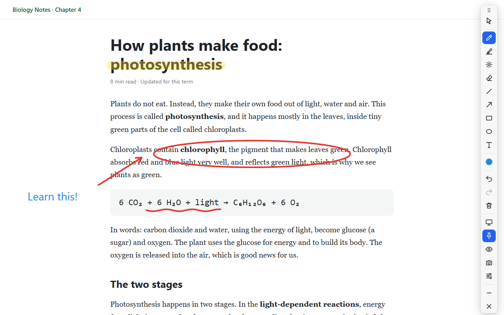

# ScrollPen

**Draw on any web page or PDF in Google Chrome, and your ink stays on the page.**
Scroll, zoom or come back tomorrow: your notes are still on the same words.
Everything stays on your computer.



## Features

- **Tools:** pen (pressure-sensitive with a pen tablet), highlighter, laser pointer, eraser
  (or your pen's eraser end), line, arrow, rectangle, ellipse and text
- **Ink that stays put:** attached to the page, it scrolls and zooms with the content, also
  inside scrolling panels within a page (chats, documents, code viewers)
- **Saved for each page:** your ink comes back when you open the page again
- **PDFs:** PDF links open in ScrollPen's own viewer so you can draw on them
- **Whiteboard and blackboard** for quick sketches
- 9 colours, adjustable sizes, filled shapes, undo/redo, hide ink, screenshots
- "Follow scrolling" switch, to keep ink fixed on the screen instead
- Hold Caps Lock to click links without leaving the pen; the mouse wheel keeps scrolling
- A toolbar you can move or shrink, and a settings page listing every page with saved ink

## Install

ScrollPen isn't on the Chrome Web Store yet. Until it is, install it from the zip:

1. Get `ScrollPen-for-friends-<version>.zip` and unzip it (right-click → **Extract All…**).
2. Move the `ScrollPen` folder somewhere it can stay, such as Documents.
3. In Chrome, open `chrome://extensions` and turn on **Developer mode** (top right).
4. Click **Load unpacked** and choose the `ScrollPen` folder.
5. Click the puzzle-piece icon next to the address bar and pin **ScrollPen**.

The full steps, including updating and removing, are in
[share/HOW TO INSTALL.txt](share/HOW%20TO%20INSTALL.txt) (also inside the zip).

## How to use

Click the ScrollPen button or press **Alt+Shift+D** on any page and draw. Press **Esc** to use
the page normally again; click **X** on the toolbar to close it (your ink stays).

| Key | Action | Key | Action |
|---|---|---|---|
| P | Pen | W | Whiteboard |
| H | Highlighter | K | Blackboard |
| L | Laser pointer | 1 – 9 | Colours |
| E | Eraser | [ ] | Smaller / bigger |
| I | Line | Ctrl+Z / Ctrl+Y | Undo / redo |
| A | Arrow | Delete | Clear the page |
| R | Rectangle | Ctrl+↑ / ↓ | Nudge ink up / down |
| O | Ellipse | Shift (while drawing a shape) | Straight lines, squares, circles |
| T | Text (Ctrl+Enter or Esc to finish) | Hold Caps Lock | Click the page without leaving the pen |

Shortcuts that work with the toolbar closed (screenshot, hide ink, clear, follow scrolling)
can be changed at `chrome://extensions/shortcuts`.

ScrollPen can't draw on Chrome's own pages (such as `chrome://` pages and the Chrome Web Store).

## Privacy

No account, no servers, no analytics, no ads, no tracking. ScrollPen never sends anything
anywhere.

- **You choose:** the first time you use it, ScrollPen asks whether to save your ink on this
  computer. Nothing is saved until you answer, and you can change it later.
- **What is saved** (only if you said yes): your ink, plus the address, title and last-drawn
  time of each page you draw on. It stays in your Chrome profile on your computer and is not
  synced anywhere.
- **See it all:** ScrollPen's settings page lists everything it stores, and can download it as
  a file or delete it. Removing ScrollPen deletes all of it.

Full details: [store/privacy-policy.md](store/privacy-policy.md). Feedback and questions:
[GitHub Issues](https://github.com/arijit-debug/ScrollPen/issues).

## For developers

Requires Node.js 22 or later.

```powershell
npm install
npm run ext:build      # -> extensions/scrollpen/dist (load it via chrome://extensions > Load unpacked)
npm run ext:watch      # rebuild on every change
npm run typecheck
npm run ext:pack       # -> release/scrollpen-<version>.zip            (for the Chrome Web Store)
                       #    release/ScrollPen-for-friends-<version>.zip (to share)
```

```
extensions/scrollpen/
  src/ink/            the drawing layer: toolbar, tools, rendering, saving
  src/background.ts   toolbar button, shortcuts, screenshots, opening PDFs in the viewer
  src/pdf/            ScrollPen's PDF viewer (pdf.js, runs locally)
  src/options/        the settings page
  scripts/            icon drawing and zip packing
share/                install steps that go inside the friends zip
store/                Chrome Web Store listing, privacy policy and publishing steps
```

To release a new version, raise `version` in both `extensions/scrollpen/manifest.json` and
`extensions/scrollpen/package.json`, then run `npm run ext:pack`. Publishing on the Chrome
Web Store: see [store/PUBLISHING.md](store/PUBLISHING.md).
